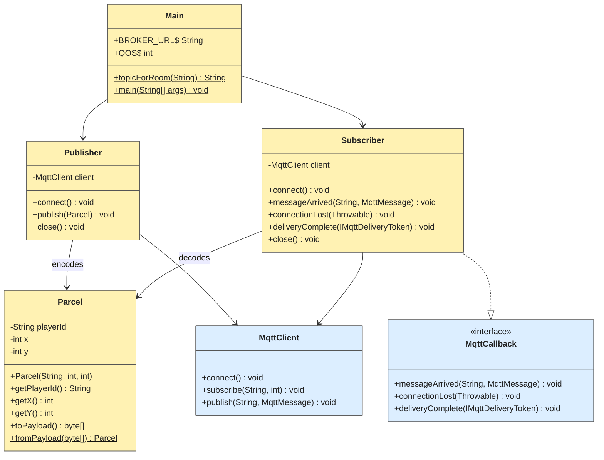
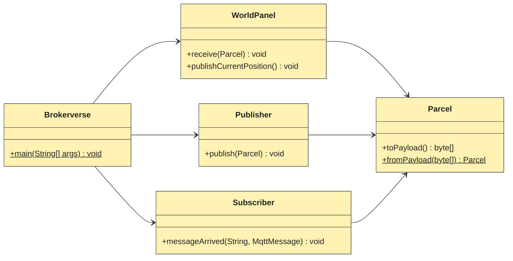

# UML class diagrams

## 1. MQTT fundamentals — console

The four application classes are shown in yellow. External Eclipse Paho types are blue.

## 2. Brokerverse — graphical extension

The GUI classes reuse the same three communication/data classes; the MQTT protocol is unchanged.

